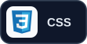

  

<picture><source media="(max-width: 600px)" srcset="assets/card-en-mobile.svg" /></picture>

  
  
  
  

## About me

- 🌎 Based in Belo Horizonte, Minas Gerais, Brazil
- 🎓 Studying Systems Analysis and Development (expected graduation in 2027) · postgraduate degree in Software Engineering <!-- TODO(Luiz): confirm the postgraduate status before publishing -->
- 🎯 Focused on React and Python, always exploring new tools
- 📈 Learning by building: sharpening my stack through personal and collaborative projects

## Technologies and tools

  
  
  
  
  
  
  
  
  
  
  
  
  
  
  
  
  
  
  

## Activity

  

## Contact

<!-- TODO(Luiz): replace the two links below with your real ones -->

  
  
  

<picture><source media="(max-width: 600px)" srcset="assets/footer-en-mobile.svg" /></picture>

