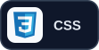
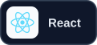
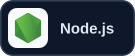
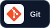
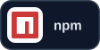

  

<picture><source media="(max-width: 600px)" srcset="assets/card-es-mobile.svg" /></picture>

  
  
  
  

## Sobre mí

- 🌎 Vivo en Belo Horizonte, Minas Gerais, Brasil
- 🎓 Cursando Análisis y Desarrollo de Sistemas (conclusión prevista para 2027)
- 🎯 Enfoque en React y Python, siempre explorando nuevas herramientas
- 📈 Aprendo construyendo: afilando mi stack en proyectos personales y colaborativos

## Tecnologías y herramientas

  
  
  
  
  
  
  
  
  
  
  
  
  
  
  
  
  
  
  

## Actividad

  

## Contacto

<!-- TODO(Luiz): cambiar los dos enlaces de abajo por los tuyos -->

  
  
  

<picture><source media="(max-width: 600px)" srcset="assets/footer-es-mobile.svg" /></picture>

