  

###

<h2 data-importer="text" align="center">import { Data as Content } from 'me/skills'</h2>

###

 

###

🌎Lagoa Santa, Minas Gerais - Brazil 🎓Estudante de Análise e Desenvolvimento de Sistemas 🚀Aspirante a desenvolvedor Fullstack em Desenvolvimento  Web e Software 🎯Foco em React, Python e mais ferramentas 📈Constantemente estudante para melhorar minhas stacks em projetos pessoais/colaborativos

###

<h1 data-importer="text" align="center">GENERAL TECHNOLOGIES & FRAMEWORKS</h1>

###

 

  
  
  
  
  
  
  
  
  
  
  
  
  
  
  
  
  
  
  
  
  
  
  
  
  
  
  

###

###

 

  

###

<picture data-importer="pacman">
  <source media="(prefers-color-scheme: dark)" srcset="https://raw.githubusercontent.com/Eubastosdev/Eubastosdev/pacman-output/bomberman-contribution-graph-dark.svg?game=bomberman">
  <source media="(prefers-color-scheme: light)" srcset="https://raw.githubusercontent.com/Eubastosdev/Eubastosdev/pacman-output/bomberman-contribution-graph.svg?game=bomberman">
  
</picture>

###

 

  
  

###

  
  

