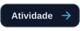
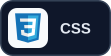
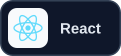
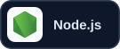
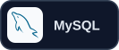
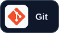
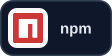

  

<picture><source media="(max-width: 600px)" srcset="assets/card-pt-mobile.svg" /></picture>

  
  
  
  

## Sobre mim

- 🌎 Moro em Belo Horizonte, Minas Gerais, Brasil
- 🎓 Cursando Análise e Desenvolvimento de Sistemas (conclusão prevista para 2027)
- 🎯 Foco em React e Python, sempre explorando novas ferramentas
- 📈 Aprendo construindo: afiando minha stack em projetos pessoais e colaborativos

## Tecnologias e ferramentas

  
  
  
  
  
  
  
  
  
  
  
  
  
  
  
  
  
  
  

## Atividade

  

## Contato

  
  
  

<picture><source media="(max-width: 600px)" srcset="assets/footer-pt-mobile.svg" /></picture>

